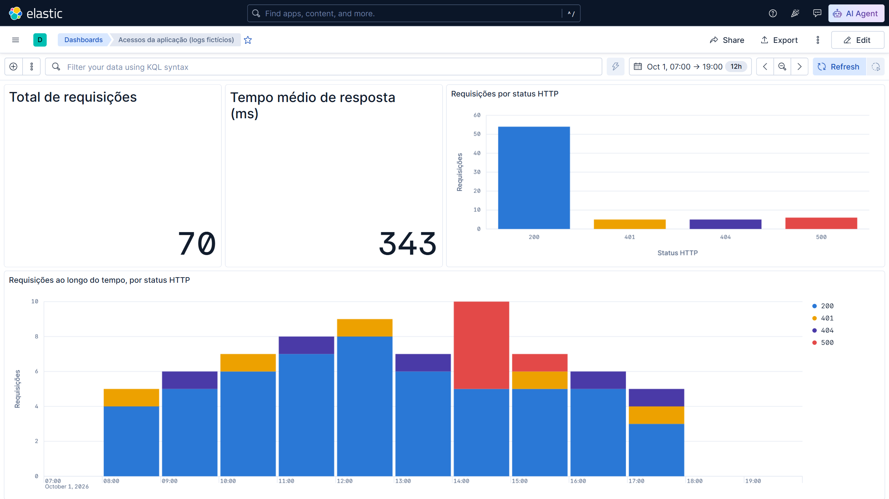

# Kibana na prática: análise de logs com Elasticsearch

Demonstração didática do **Kibana** para o seminário técnico da disciplina **Projeto de Desenvolvimento de Dashboard Analítico** (Avaliação de Produto 2): apresentação de 7 a 20 minutos com slides e demonstração prática da ferramenta.

> **Ambiente local didático para demonstração e desenvolvimento, não destinado à produção.**

## Objetivo

Mostrar, com um pequeno arquivo de logs fictícios de uma aplicação web, como o Kibana permite explorar, filtrar e visualizar dados armazenados no Elasticsearch: **Discover**, filtros **KQL**, **Lens** e **Dashboard**.

## Arquitetura

```text
data/acessos.csv
      │  "Upload a file" (recurso nativo do Kibana)
      ▼
Elasticsearch 9.5.5 ── índice "acessos" (70 documentos)       porta 9200
      ▲
      │  consultas
Kibana 9.5.5 ── Data View "acessos" → Discover · Lens · Dashboard  porta 5601
      ▲
      │  http://localhost:5601
Navegador
```

Os dois serviços rodam em containers definidos em [docker-compose.yml](docker-compose.yml), na mesma versão (exigência da Elastic) e acessíveis apenas pela própria máquina (`127.0.0.1`).

| Caminho | Finalidade |
|---|---|
| `docker-compose.yml` | Sobe Elasticsearch e Kibana (nó único, ambiente local) |
| `data/acessos.csv` | 70 requisições fictícias de uma aplicação web em 01/10/2026 |
| `kibana/dashboard_acessos.ndjson` | Objetos exportados do Kibana: Data View, 4 visualizações Lens e o dashboard |
| `docs/` | Conteúdo do seminário, roteiros e referências |
| `slides/` | Apresentação (`.pptx`), script que a gera e captura do dashboard |

## Pré-requisitos

- Docker Desktop (Windows/macOS) ou Docker Engine (Linux) com Docker Compose v2;
- cerca de 3 GB de RAM livres para os containers. No Windows, a VM do Docker (WSL 2) usa por padrão no máximo metade da RAM da máquina; com 8 GB, feche outros programas antes de subir o ambiente;
- cerca de 5 GB de disco para as imagens e internet no primeiro `docker compose up` (download);
- navegador atualizado (Chrome, Edge ou Firefox).

## Como executar

**1. Subir o ambiente**

```bash
docker compose up -d
```

O comando espera o Elasticsearch ficar saudável e só então inicia o Kibana; o ambiente completo leva de 2 a 3 minutos para ficar pronto.

**2. Verificar**

```bash
docker compose ps            # elasticsearch e kibana devem aparecer como "healthy"
curl http://localhost:9200   # resposta JSON com "number" : "9.5.5"
```

No Windows PowerShell, use `curl.exe` no lugar de `curl` (ou abra os endereços no navegador).

**3. Acessar o Kibana:** <http://localhost:5601>. Na primeira visita, clique em **Explore on my own**.

**4. Importar o dashboard (uma única vez):** na busca do topo, digite **Saved objects** e abra o resultado → **Import** → selecione `kibana/dashboard_acessos.ndjson` → **Import** → **Done**. São criados o Data View `acessos`, as visualizações e o dashboard *Acessos da aplicação (logs fictícios)*.

**5. Carregar o CSV:** **Home** → **Upload a file** → em *Index name* digite `acessos` → selecione `data/acessos.csv` → confira a prévia (tipos dos campos) → **Advanced options** → desligue **Create data view** → **Import**.

O Data View já veio na importação do passo 4; se a opção ficar ligada, os dados são carregados normalmente, mas o Kibana mostra o erro `DuplicateDataViewError` ao final.

Pronto: o Discover mostra 70 documentos e o dashboard passa a exibir os dados. Como os registros são de 01/10/2026, no Discover use **Search entire time range** (o dashboard já abre no intervalo certo).

## Roteiro resumido da demonstração (≈ 5 min)

1. Mostrar o CSV (5 colunas, 70 linhas).
2. Importar o CSV pelo Kibana (*Upload a file*) e comentar os tipos inferidos.
3. **Discover** → *Search entire time range* → 70 documentos.
4. Filtro KQL `status_code >= 500` → 6 erros, todos em `/pedidos`, entre 14h e 15h.
5. **Lens**: campo `endpoint` → *Visualize* → salvar no dashboard.
6. **Dashboard**: visão geral e o pico de erros às 14h.

Passo a passo, tempos, diagnóstico e contingência: [docs/roteiro_demonstracao.md](docs/roteiro_demonstracao.md).



## Desligar

```bash
docker compose down      # para os containers e mantém os dados
docker compose down -v   # para e apaga os dados (índice, Data View e dashboard)
```

## Limitações do ambiente didático

- **Segurança desabilitada** (`xpack.security.enabled=false`): sem login e sem TLS, para simplificar a demonstração. É uma simplificação didática, nunca uma recomendação de produção; o próprio Kibana exibe o aviso *Your data is not secure*.
- **Nó único:** sem réplicas nem alta disponibilidade. O índice `acessos` fica com status `yellow` (a réplica não tem outro nó para ser alocada), o que é esperado aqui.
- **Upload a file** serve para exploração inicial, não para ingestão contínua; em produção os dados chegam por Elastic Agent, Logstash ou APIs.
- **Dados fictícios e pequenos** (70 linhas), escolhidos para serem fáceis de conferir.

## Documentação

- [docs/conteudo_seminario.md](docs/conteudo_seminario.md): conteúdo teórico do seminário
- [docs/roteiro_apresentacao.md](docs/roteiro_apresentacao.md): roteiro da fala (≈ 14 min)
- [docs/roteiro_demonstracao.md](docs/roteiro_demonstracao.md): demonstração, diagnóstico e contingência
- [docs/referencias.md](docs/referencias.md): fontes consultadas

Os slides (`slides/seminario_kibana.pptx`) são gerados por `slides/gerar_slides.py`. Para regenerar: `pip install python-pptx` e `python slides/gerar_slides.py`.
